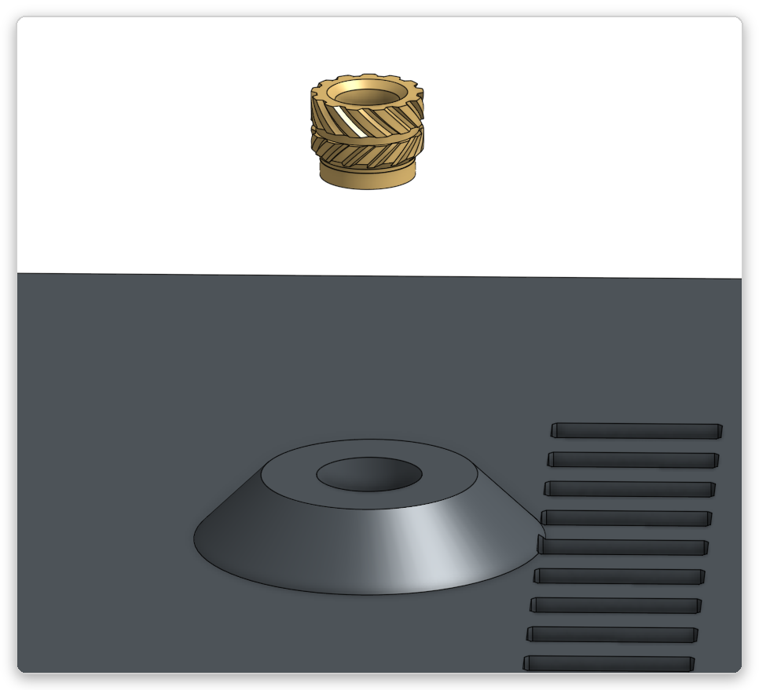
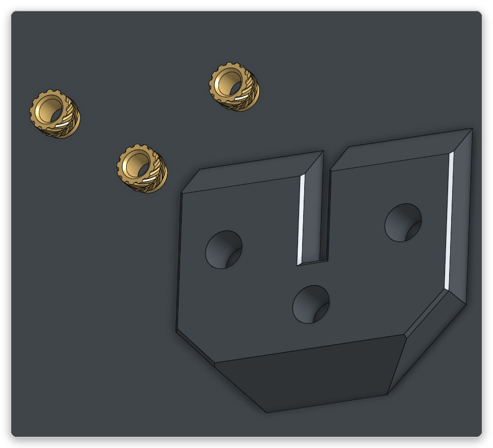
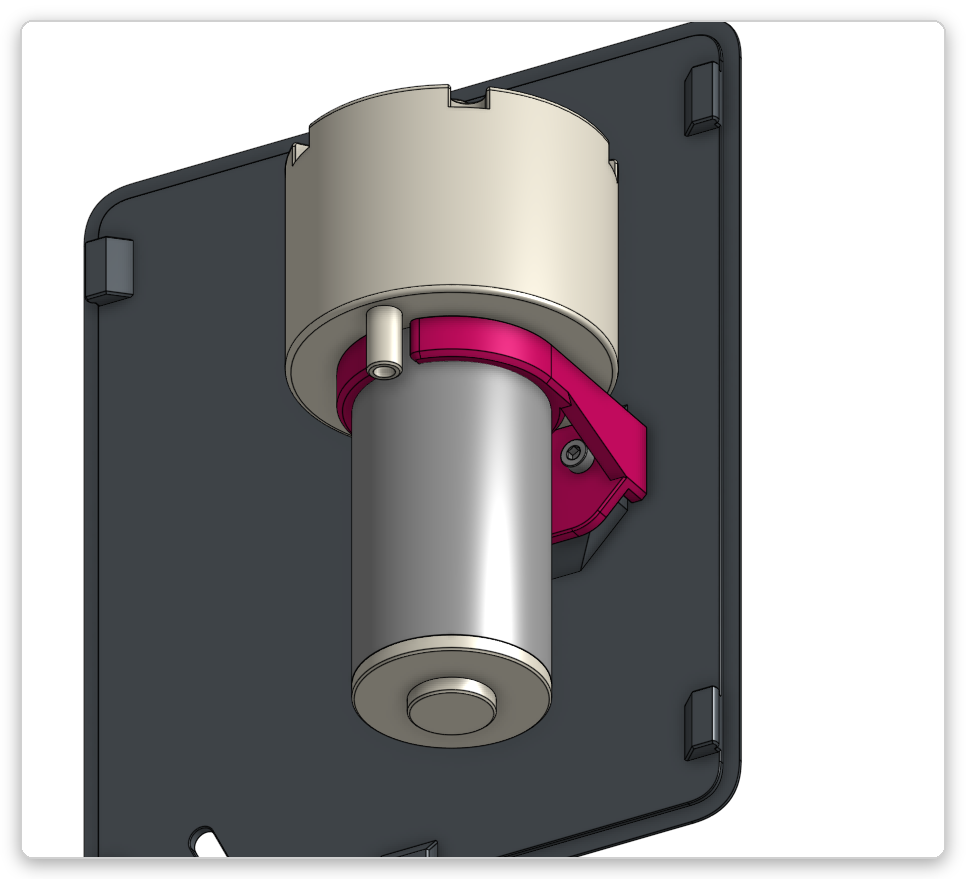
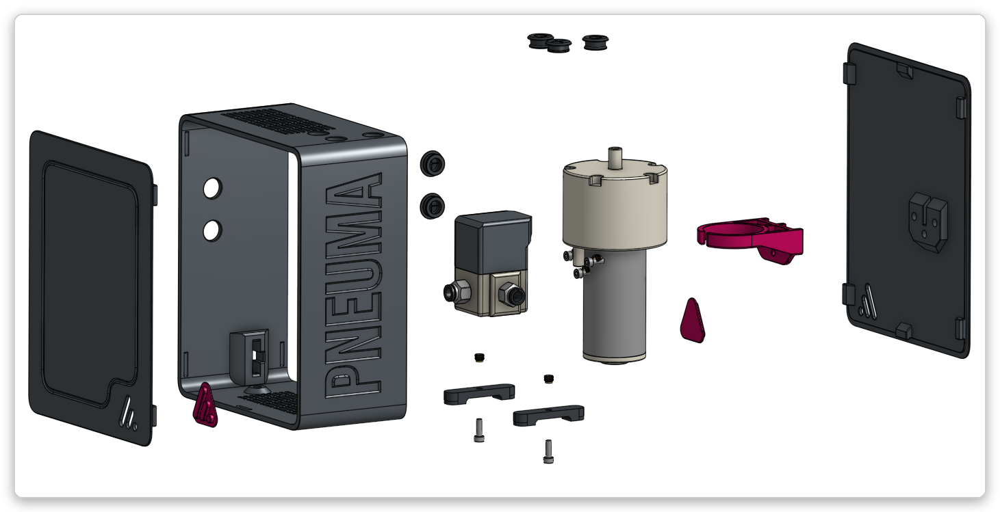
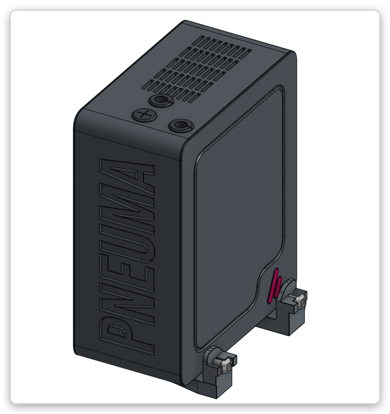
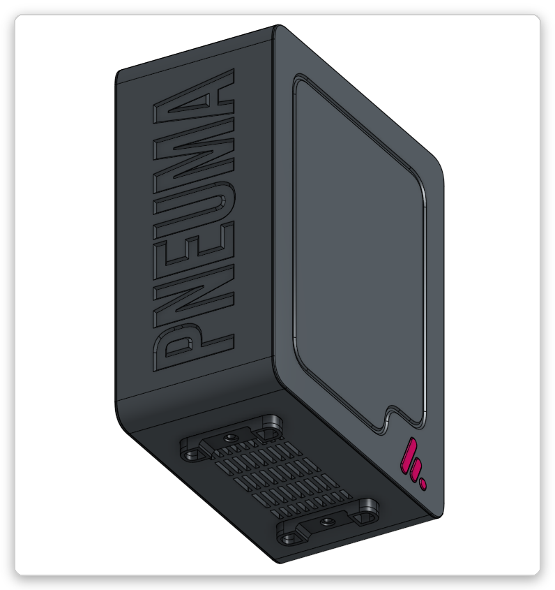

# 🛠️ Pneuma Part Cooling Assembly Guide

Welcome to the assembly guide for the Pneuma Part Cooling system.

> [!NOTE]
> **Dual-Pump Architecture**
> Pneuma uses a dedicated dual-pump layout (`pump_cool` for ambient room air and `pump_warm` for internal chamber air), removing the legacy single-pump solenoid valve while keeping the core mechanical assembly principles unchanged.

## Tools Required
- Hex keys
- Flush cutters
- Tube cutter
- Soldering iron (for `M3x5x4mm` brass heat-set inserts)

> [!CAUTION]
> **Fastener Torque & Threadlocker Notice**
> - **3D-Printed Parts:** Do **not** torque screws into printed plastic (`ABS`, `ASA`, or `PETG`) to metal specs—stop turning immediately once the plastic begins to compress to prevent layer delamination or stripped bosses.
> - **Anaerobic Threadlocker:** Never allow liquid or vapor threadlocker (`Loctite 243` / `Loctite 222MS`) to contact **ABS or ASA** printed parts (causes rapid chemical stress-cracking), and never use red high-strength threadlocker.

> [!WARNING]
> **Builder Responsibility**
> This is an aftermarket engineering project. You are solely responsible for your own safety and the integrity of your equipment when building and operating this system. By using these files and instructions, you accept all liability.

---

## Step 1: Heat-Set Inserts

Press `5` `M3x5x4mm` brass heat-set inserts (`[TBD: CONFLICT — 5 in BOM vs 2 Ø4.70mm on Main_Body + 6 Ø4.70mm on Rear_Cover STEP]`) squarely into `Pneuma_201 parts - Main_Body.stl` and `Pneuma_201 parts - Rear_Cover.stl` until flush with the surrounding plastic surface so protruding brass rims cannot create a seam gap between the enclosure halves.

  
  

 
*Fig. 1: Install `M3x5x4mm` heat-set inserts flush into `Pneuma_201 parts - Main_Body.stl` and `Pneuma_201 parts - Rear_Cover.stl`.*

---

## Step 2: Pump Mounting

Secure each vacuum pump to its `Pneuma_201 - Pump_Mount.stl` bracket using `2` `M3x8 SHCS` screws (`[TBD: confirm_4x_M3x8_SHCS_for_dual_pump_mounts]`).

 
*Fig. 2: Secure the vacuum pump to `Pneuma_201 - Pump_Mount.stl` using `M3x8 SHCS` screws.*

---

## Step 3: Main Assembly & Pneumatic Routing

Install both mounted pumps (`pump_cool` and `pump_warm`) inside `Pneuma_201 parts - Main_Body.stl`, route the `6mm OD` pneumatic tubing and `20AWG` power wiring through the enclosure pass-through ports using `Pneuma_201 - TPU_Grommet.stl` grommets, `Pneuma_201 - Plug_Grommet_TPU.stl` blanking plugs (for unused ports), or as-needed tube fittings (`[TBD: optional_tube_adapter_stl_files]`), and fasten `Pneuma_201 parts - Front_Cover.stl` and `Pneuma_201 parts - Rear_Cover.stl` (`[TBD: rear_cover_to_main_body_m3_screw_length_and_qty]`).

> [!NOTE]
> **Threaded Fittings**
> Wrap Teflon tape on the pressure side of threaded `1/8 NPT` (`6mm OD`) fittings to prevent air leaks and line-pressure drop (`>= 70 kPa`).

> [!WARNING]
> **Tubing Bend Radius**
> Route the `6mm OD` pneumatic tubing with generous sweep radii and use the right-angle `1/8 NPT` (`6mm OD`) fitting on the pump intake where space is tight. Sharp bends or kinked lines will restrict airflow and reduce part-cooling performance.

> [!NOTE]
> **Legacy Single-Pump Solenoid Valve Routing (`v1.x`)**
> If assembling a legacy single-pump build with a direct-acting `1/8 NPT` 3-way solenoid valve, route the common valve outlet to the pump intake, connect one switching inlet to ambient room air, and route the second switching inlet from the heated chamber to supply warm air for `ABS`/`ASA` printing.

 
*Fig. 3: Exploded view of the primary Pneuma enclosure assembly.*

---

## Step 4: Optional Mounting Solutions

Mount the assembled Pneuma enclosure either to `20`-series aluminum extrusion using `Pneuma_201 - Extrusion_Mount_A.stl` and `Pneuma_201 - Extrusion_Mount_B.stl` with `2` `M3x10 SHCS`, `2` `M5x12 BHCS`, and `2` `M5` roll-in T-nuts, or to a table/enclosure surface using `2` `Pneuma_201 - Table_Mount_TPU.stl` vibration-isolator feet and `2` `M3x10 SHCS`.

  
  

 
*Fig. 4: Optional `20`-series extrusion mount (left) and TPU table mount (right).*

---

### End of Assembly
The Pneuma Part Cooling system is now assembled and ready for Klipper integration via [`Firmware/Pneuma_Control.cfg`](Firmware/Pneuma_Control.cfg)!

***

> ☕ **Did you find this guide helpful?** 
> 
> My projects are open-source and free for the community. If you've enjoyed my designs and want to support my work, consider [leaving me a tip on Ko-fi](https://ko-fi.com/alchemical3d)! 
>
> 

***
*Documentation prepared with AI editorial assistance • Engineered & maintained by Alchemical-3D.*
