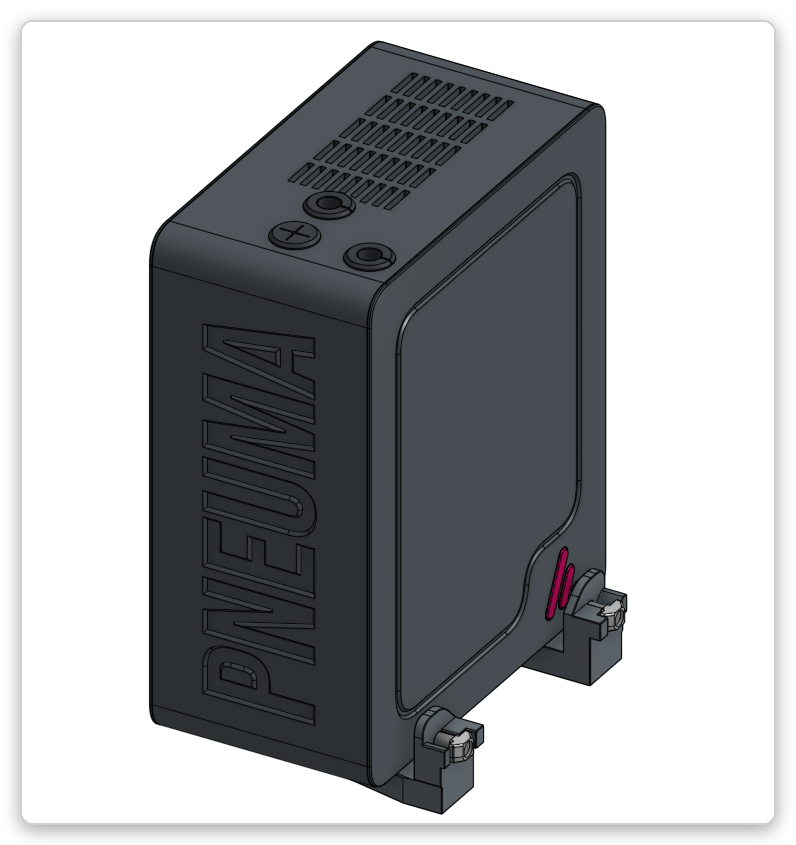
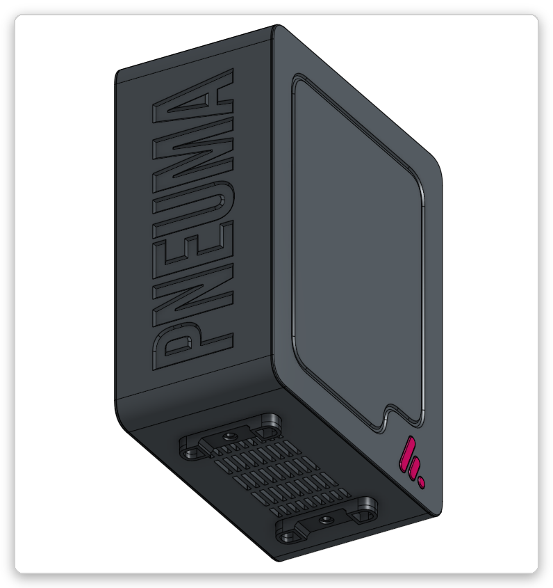

# 🌬️ Pneuma Part Cooling

> [!NOTE]
> **Dual-Pump Architecture**
> Pneuma has been upgraded to a dedicated dual-pump system (replacing the previous single-pump and direct-acting solenoid valve layout). This allows for independent, granular control over ambient room air (`pump_cool`) and warm internal chamber air (`pump_warm`).

A high-performance pneumatic part cooling system designed for the Alchemical-3D ecosystem. Pneuma uses remote vacuum pumps and pneumatic tubing to deliver focused compressed-air cooling to toolheads such as the [Alembic](https://github.com/Alchemical-3D/Alembic_Toolhead).

  
  &nbsp;
  

 

## 📚 Documentation Index

Everything you need to set up and configure the Pneuma system:

| Category | Description |
| :--- | :--- |
| 📋 **[Bill of Materials (BOM)](BOM.md)** | The comprehensive checklist of printed parts, pumps, tubing, and hardware needed. |
| 🛠️ **[Assembly Guide](Assembly_Guide.md)** | A step-by-step walkthrough for putting the Pneuma system together. |
| ⚙️ **[Print Settings](Print_Settings.md)** | Essential slicer configurations, material recommendations, and TPU isolation notes. |

 

---
> [!IMPORTANT]
> **Alpha Release**
> This project is currently in the **Alpha phase** of development. Please expect ongoing changes, updates, and improvements to the designs and documentation as the system evolves.

> [!TIP]
> **Looking for a Compatible Toolhead?** 
> *If you're interested in this project, check out the **[Alembic Toolhead](https://github.com/Alchemical-3D/Alembic_Toolhead)** project! It is a lightweight, high-performance toolhead designed for the Alchemical-3D ecosystem to use Pneuma's remote compressed air architecture.*

## 🌪️ System Capabilities & Benefits

Pneuma provides an alternative approach to part cooling by relocating airflow generation away from the toolhead. By using remote vacuum pumps and pneumatic tubing, Pneuma offers several distinct advantages:

- **Targeted Cooling:** By replacing wide-area blowers with focused, high-velocity air at the nozzle exit, Pneuma and a compatible toolhead help improve overhangs and fine details.
- **Air Source Control:** When paired with Klipper, users can dynamically select their air source—switching between ambient room air (`pump_cool`) or warm internal chamber air (`pump_warm`). Pneuma uses dual dedicated pumps for this, providing reliable options for different filament regimes.
- **Smart Macro Integration:** Pneuma uses custom Klipper macros to intercept standard part cooling commands (`M106`/`M107`). The system can be commanded manually through the Klipper interface, or through your slicer's standard G-code by embedding a mode toggle in your filament profiles.
- **Lightweight Toolheads:** Due to removing on-toolhead part-cooling blowers, toolheads like the [Alembic](https://github.com/Alchemical-3D/Alembic_Toolhead) shed mass, directly benefiting mechanical performance during high-acceleration motion.
- **Noise Mitigation:** Pneuma uses enclosed diaphragm pumps isolated on TPU mounts designed to run quieter than unshielded pressurized air setups.
- **Enhanced Visibility:** Removing bulky fans provides a clearer, less obstructed view of the extrusion process, aiding in visual or camera-based print monitoring.
- **Adaptable Performance:** The modular design allows users to swap pump capacities to suit their specific cooling needs and materials.

---

## ✨ Key Specifications & Features

- **Cooling Delivery:** High-speed compressed air routed via dedicated `6mm OD` pneumatic tubing.
- **Pump Baseline:** Minimum flow rate `> 10L/min`, positive pressure `>= 70 kPa`, and vacuum `<= -40 kPa`.
- **Ecosystem Compatibility:** Compatible with the Alchemical-3D [Alembic](https://github.com/Alchemical-3D/Alembic_Toolhead) and the [A3DP Gantry Assembly](https://github.com/Alchemical-3D/A3DP_Gantry_Assembly), as well as other remote-air toolheads.

---

## 🎛️ Firmware & Control

Pneuma relies on a custom Klipper configuration to route standard part cooling commands to the active pump(s), allowing you to retain native slicer cooling behaviors while using dual air sources.

### Klipper Configuration
The configuration file is located here: **[Pneuma_Control.cfg](Firmware/Pneuma_Control.cfg)**

1. **Install:** Place `Pneuma_Control.cfg` in your Klipper configuration directory and `[include]` it in your `printer.cfg`.
2. **Assign Pins:** Open the file and assign the MCU pins for `pump_cool` (default `PF7`) and `pump_warm` (default `PF9`).
3. **Remove Old Fans:** Comment out or delete your default `[fan]` section in `printer.cfg` to prevent pin conflicts.

> [!IMPORTANT]
> **Shutdown Speed Safety (`shutdown_speed: 0` vs. Hotend Fans)**
> Both `[fan_generic pump_cool]` and `[fan_generic pump_warm]` in `Pneuma_Control.cfg` set `shutdown_speed: 0` (`min_power: 0.15`, `max_power: 1.0`) so the part-cooling diaphragm pumps de-energize if Klipper enters an MCU shutdown or fault state. Keep in mind though, dedicated **hotend heatsink fans (`[heater_fan]`)** on your toolhead must remain set to `shutdown_speed: 1` so the heatsink continues cooling while the hotend sheds residual heat.

### How to Use
The system intercepts standard `M106` (fan on) and `M107` (fan off) commands. You can dynamically switch which pump receives these commands using the `SET_PNEUMA_MODE` macro.

**Available Modes:**
- `MODE=COOL` : Routes all cooling commands to `pump_cool` (external ambient room air). Ideal for PLA, PETG, and materials needing maximum thermal extraction.
- `MODE=WARM` : Routes all cooling commands to `pump_warm` (internal chamber air). Ideal for ABS, ASA, and materials sensitive to drafts or warping.
- `MODE=DUAL` : Spins up *both* pumps simultaneously when cooling is requested. Reserved for maximum airflow needs.
- `MODE=OFF` : Disables part cooling routing to both pumps (`SPEED=0.0`), ignoring slicer commands until a new mode is set.

**Implementation Examples:**
- **Via Slicer:** Add `SET_PNEUMA_MODE MODE=WARM` to your filament start G-code for ABS/ASA, or `MODE=COOL` for PLA.
- **Via Console:** Type `SET_PNEUMA_MODE MODE=DUAL` in the Klipper terminal for a quick override.
- **Automatic Routing:** When the slicer requests cooling (e.g., `M106 S255`), Klipper sends the PWM signal (`0.0`–`1.0`) only to the active pump(s). If you change modes mid-print, `variable_last_speed` is immediately re-applied to the newly selected pump.

***

## ⚖️ License

This project is licensed under the **Creative Commons Attribution-NonCommercial-ShareAlike 4.0 International License**. See the [LICENSE.md](LICENSE.md) file for details.

***

**[Join the Discord!](https://discord.gg/aE49DW2xXe)**

> ☕ **Did you find this guide helpful?** 
> 
> My projects are open-source and free for the community. If you've enjoyed my designs and want to support my work, consider [leaving me a tip on Ko-fi](https://ko-fi.com/alchemical3d)! 
>
> 

***
*Documentation prepared with AI editorial assistance • Engineered & maintained by Alchemical-3D.*
